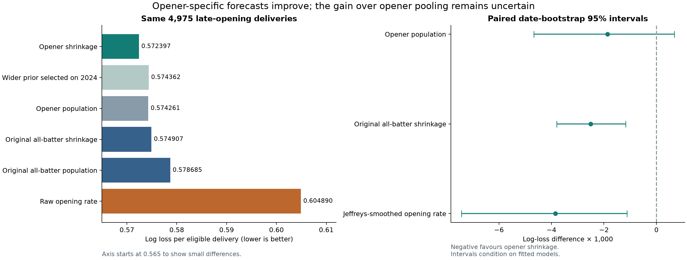
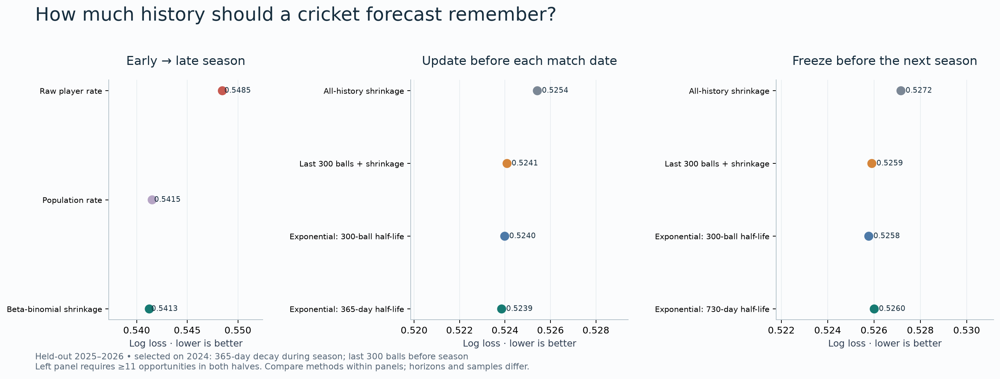
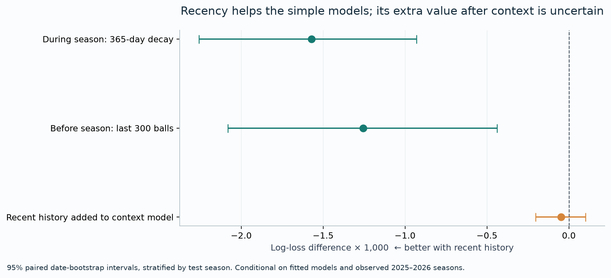

# IPL form forecasting

### How quickly should we believe a batter has improved?

A Python research project adapting Brown's baseball forecasting question to IPL boundary probabilities, then testing whether forecasts improve when older observations receive less weight.

## New: opening-batter experiment 1 follow-up (13 October 2026)

**Opener-specific shrinkage improves log loss by 0.44% over the original all-batter shrinkage forecast on the same 4,975 late-opening deliveries in 2025–2026.** It beats raw rates, but its advantage over an opener-only population remains uncertain. The opener prior is usually narrower, and deliberately widening it worsens evaluation forecasts. A more appropriate prior centre explains most of the gain.

This is an exploratory follow-up motivated by known original results. Only experiment 1 was extended; the later experiments and dated 2027 forecasts below are unchanged.

**[Read the opener results](docs/OPENERS_REPORT.md)** · [Detailed plan for later experiments (not implemented)](docs/OPENERS_NEXT_STEPS.md) · [Follow-up protocol](docs/OPENERS_PROTOCOL.md) · [Numerical evidence](results/openers)



To reproduce this extension alone, run `python pipeline.py` if processed tables are missing, then `python openers_experiment.py`, `python build_openers_report.py`, `python verify_openers.py` and `python -m pytest -q`. Open `docs/openers.html` for its self-contained local viewer. The original `run_all.py` reproduces the original study; it does not run or select this extension.

## Original full-project findings (12 October 2026)

**Finding:** a 365-day decay model selected on 2024 improves delivery-weighted log loss by **0.30%** over all-history shrinkage on 2025–2026. The incremental gain after context adjustment is uncertain. Recent weighting improves simple predictions here; that is not proof of permanent player improvement.



**[Read the full research report](docs/RESEARCH_REPORT.md)** · [Results notebook](02_research_results.ipynb) · [2027 improver candidates](results/watchlist_improvers.csv) · [2027 rebound candidates](results/watchlist_rebounds.csv) · [All 2027 forecasts](results/forecast_2027_all.csv)

## What is here

- A checksum-pinned Cricsheet archive and tested cleaning pipeline: **1,243 matches, 295,732 recorded deliveries, 284,465 modelling opportunities**, 2008–2026.
- An early-to-late-season beta-binomial shrinkage experiment inspired by Brown (2008).
- Past-only expanding, current-season, rolling and exponential histories spanning multiple seasons.
- Separate within-season and preseason model selection on 2024, followed by evaluation on 2025–2026.
- Log loss, Brier score, calibration, equal-player metrics, paired date-bootstrap uncertainty and context/phase/venue/opposition checks.
- Dated 2027 boundary-rate forecasts with block-resampling stability intervals; six figure sets and two executed notebooks.

## Key results

| Experiment | Selected model | Test log loss | Expanding reference | What it supports |
|---|---|---:|---:|---|
| Updated before each match date | 365-day exponential decay | 0.523852 | 0.525423 | Modest improvement for opportunity-weighted forecasts |
| Frozen before the season | Last 300 balls + shrinkage | 0.525908 | 0.527164 | Some recent information persists across the off-season |
| Recency added to contextual model | Context + recent-history signal | 0.517950 | 0.517997 | Difference is uncertain; not evidence of isolated skill change |

These horizons have different information sets. Compare models within each experiment. Equal-player results do not always favour the selected method. Brown's exact baseball numbers and full estimator suite are not replicated.



## Reproduce

Python 3.13 is the tested interpreter. Create a local environment, install the portable dependencies, and run:

```bash
python3 -m venv .venv
source .venv/bin/activate
python -m pip install -r requirements.txt
python run_all.py
python -m pytest -q
```

On Windows activate with `.venv\Scripts\activate`. The raw 5 MB archive is included under its data license, so analysis does not need a live download. The run rebuilds cleaned tables, experiments, uncertainty, figures, reports and executed notebooks. It can take several minutes, particularly the 1,000 watchlist prior resamples. `requirements.lock.txt` records the tested macOS environment; use `requirements.txt` across platforms. No API key is required for research reproduction.

Open `docs/research.html` locally for the self-contained report viewer and filterable forecast table. GitHub renders the Markdown report and notebooks directly; it does not run the HTML viewer in a repository file preview.

## Project map

| Path | Purpose |
|---|---|
| `pipeline.py` | Validate and flatten Cricsheet; clean outcomes and build counts |
| `models.py` | Prior estimation, posterior means, historical features and scoring |
| `research.py` | Brown-inspired, sequential and preseason experiments |
| `context_analysis.py` | Past-trained contextual models and subgroup checks |
| `watchlists.py` | Dated forecasts and resampling intervals |
| `visualise.py`, `build_report.py` | Figures and research write-up |
| `01_data_walkthrough.ipynb` | Explain the data and shrinkage |
| `02_research_results.ipynb` | Inspect actual model choices, results and watchlists |
| `config/protocol.json`, `docs/PROTOCOL.md` | Frozen study choices |
| `results/`, `figures/`, `tests/` | Evidence, visualisations and verification |
| `docs/INTERVIEW_GUIDE.md` | Explain the question, findings and limitations |

## Outcome and interpretation

A boundary is a batter four/six unless explicitly marked non-boundary. Primary opportunities exclude wides, no-balls and Super Overs; byes and leg-byes on legal balls remain zero outcomes. Player IDs prevent name-matching errors. Historical features exclude all same-date outcomes. Match winners and final revised chase targets are never forecast features.

The 2027 forecasts are dated **12 October 2026**, use data through **31 May 2026**, and are conditional on a player batting. They do not predict injuries, selection, overall batting quality or guaranteed improvement. Watchlist intervals measure resampling stability, not the full uncertainty of realised next-season performance. See the full report for source coverage, dependence, calibration, era changes and selection limitations.

## References and attribution

[Brown (2008)](https://www.stat.berkeley.edu/users/aldous/157/Papers/brown_batting.pdf) supplies the forecasting/shrinkage motivation. [Cricsheet](https://cricsheet.org/) supplies the data, licensed under the [Open Data Commons Attribution License 1.0](https://opendatacommons.org/licenses/by/1-0/); see [DATA_LICENSE.md](DATA_LICENSE.md). Code is MIT licensed. Data cleaning, aggregation and analysis are this project's transformations; Cricsheet does not endorse the results. Built with Codex assistance, with reproducible code and checks provided.
