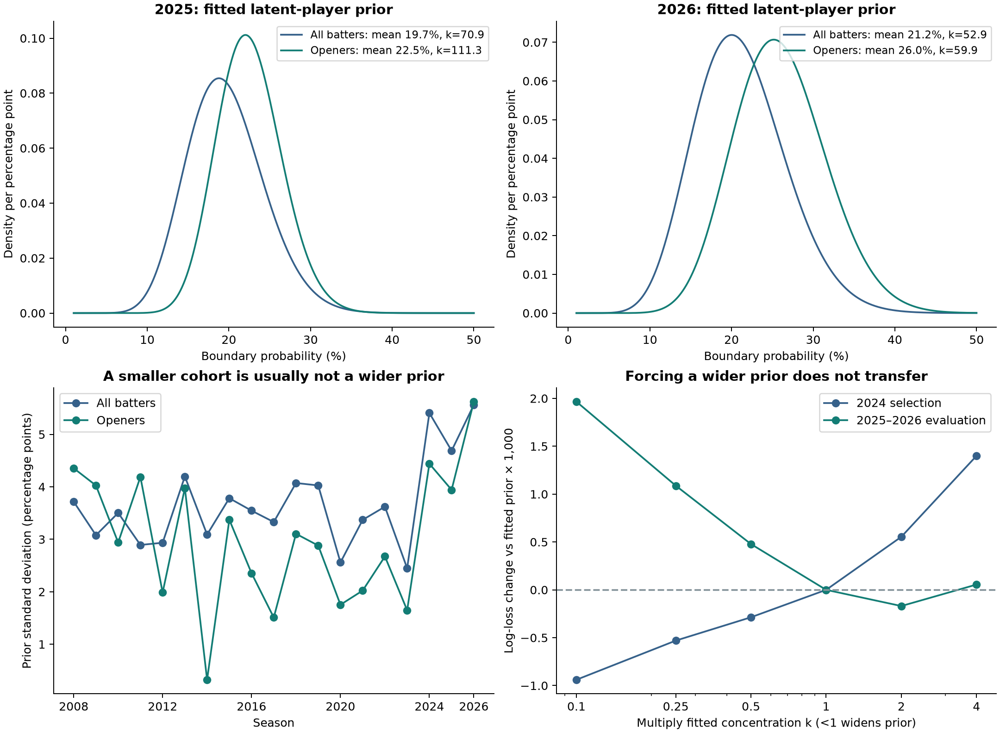

# Opening batters: does shrinkage improve?

**Experiment 1 follow-up · 13 October 2026 · exploratory analysis**

## Finding

**Yes, using opener-specific training improves forecasts for openers relative to the original all-batter shrinkage model: 0.44% lower log loss on the same 4,975 late-opening deliveries in 2025–2026.** The paired date-bootstrap interval for the difference excludes zero, conditional on the fitted models. Shrinkage also beats raw rates. Its 0.32% point improvement over an **opener-only population** remains uncertain. This is evidence for a better role-matched forecast, not a conclusive win for individualisation over role-matched pooling.

**The narrower-prior explanation is not supported.** The opener prior is narrower in 2025 and nearly the same width in 2026. Forcing a wider prior worsens evaluation forecasts. The main benefit is associated with a more appropriate, higher prior centre for opening batters.


## What was repeated, and what was preserved

Only experiment 1 was rerun. The original sequential, preseason, contextual and 2027 watchlist code/results were preserved byte-for-byte, along with the original experiment-1 outputs. This extension has its own configuration, results folder, figures and report. [The future-work plan](OPENERS_NEXT_STEPS.md) proposes subsequent changes; none were executed.

The original outcomes were already known when this question was proposed. Therefore 2025–2026 are an **exploratory evaluation period**, not a newly untouched confirmatory test. The opener protocol was committed before its first fit. Development summaries cover 2008–2023; 2024 alone chooses the optional width multiplier. No 2025–2026 result changes that selection. The added parameter-swap diagnostics below are explicitly post-protocol.

## Opening-batter definition and coverage

The opening pair is the batter and non-striker on the first recorded event of each ordinary innings, even if that event is illegal. Membership agrees exactly with the pipeline's entry positions 1–2. There are 151 innings with an illegal first event; identifying the first two players to face legal balls would be unsafe. All recorded innings start in over zero. Nine of the 4,960 opening-pair slots have no eligible batting delivery; they are not invented zero-rate records.

An eligible outcome is the same legal-delivery batter boundary as before, excluding no-balls, wides and Super Overs, preserving legal byes/leg-byes as zeroes and respecting non-boundary flags. All of an opener's eligible deliveries in that innings count, including later overs. Their non-opening innings do not enter the opener fit or target. Players can change role; this is an innings role, not a permanent career label. Outcomes are conditional on actually opening, not a prediction of selection or opening probability.

The complete opener sample contains **105,948 opportunities, 20,717 boundaries and 4,951 observed opening batter-innings** over 2008–2026. The primary comparison scores **4,975 opportunities, 1,293 boundaries, 240 batter-innings, 53 player-seasons, 38 distinct players and 54 match dates** in the late halves of 2025–2026.

| Season | Early openers | Late openers | Early balls | Late balls | No early-opening history | Their late balls |
| --- | --- | --- | --- | --- | --- | --- |
| 2025 | 32 | 28 | 3643 | 2319 | 3 | 67 |
| 2026 | 30 | 25 | 3226 | 2656 | 5 | 278 |

Eight late player-season records have no early-opening opportunities, accounting for 345 scored balls (6.93%). Three of those records have earlier non-opening history; that history is excluded from the opener model but available to the original-model comparator. Raw and pooled forecasts fall back to the pooled opener rate; empirical Bayes falls back to its fitted prior mean, exactly as the original implementation does. These two population centres are not identical.

Shared calendar cutoffs, with complete dates together, match the original experiment. Forecasts use early outcomes only and remain fixed for the late half. The >=11 subset is a retrospective evaluation restriction, never a training or player-selection rule.

## Results on identical opening deliveries

Lower scores are better. Equal-player scores first aggregate all evaluation opportunities for each player and then average across the 38 players; player-rate MSE in the CSV instead averages player-season rates. The original all-batter models are rescored on the **same opening deliveries**, so this comparison does not confuse a changed target population with a better model.

| Model | Log loss ↓ | Brier ↓ | Equal-player log loss ↓ |
| --- | --- | --- | --- |
| Opener shrinkage | 0.572397 | 0.192067 | 0.545301 |
| Opener population | 0.574261 | 0.192824 | 0.547709 |
| Raw opening rate | 0.604890 | 0.193500 | 0.636032 |
| Original all-batter shrinkage | 0.574907 | 0.192881 | 0.548775 |
| Original all-batter population | 0.578685 | 0.194367 | 0.548704 |
| Wider prior selected on 2024 | 0.574362 | 0.192741 | 0.549264 |

Opener shrinkage improves log loss by 5.37% against raw rates, 0.44% against the original shrinkage forecast, and 0.32% against the opener population forecast. These are relative loss reductions, not percentage-point increases in boundary probability or prediction accuracy.

Paired loss differences use 2,000 bootstrap resamples of whole match dates within each evaluation season. Negative favours opener shrinkage:

| Reference | Shrinkage minus reference | 95% low | 95% high |
| --- | --- | --- | --- |
| Opener population | -0.001865 | -0.004677 | 0.000684 |
| Raw opening rate | -0.032493 | -0.072135 | -0.002068 |
| Jeffreys-smoothed opening rate | -0.003852 | -0.007430 | -0.001116 |
| Original all-batter shrinkage | -0.002510 | -0.003801 | -0.001167 |

The Brier difference versus opener pooling is -0.000757, interval [-0.001865, 0.000217], also crossing zero. Against original shrinkage it is -0.000813, interval [-0.001269, -0.000333]. Both log loss and Brier therefore support the same qualified interpretation.

### Are raw rates making the gain look too large?

Raw 0/1 forecasts require clipping at 10^-6 for log loss. Their Brier/MSE scores remain unclipped in this extension; the original common scoring helper clipped Brier too, a negligible discrepancy corrected locally without modifying the earlier studies. A Jeffreys-smoothed individual rate scores **0.576248**, still worse than fitted opener shrinkage, but much closer than raw log loss.

The >=11-in-both-opening-halves subset contains 4,543 late balls and 40 player-seasons:

| Model | Log loss ↓ | Brier ↓ | Equal-player log loss ↓ |
| --- | --- | --- | --- |
| Opener shrinkage | 0.570277 | 0.191119 | 0.550943 |
| Opener population | 0.572420 | 0.191985 | 0.556121 |
| Raw opening rate | 0.572453 | 0.191906 | 0.551385 |
| Original all-batter shrinkage | 0.571547 | 0.191515 | 0.550592 |
| Wider prior selected on 2024 | 0.571830 | 0.191681 | 0.550898 |

Here shrinkage minus raw log loss is -0.002177, interval [-0.003747, -0.000670]; versus opener pooling it is -0.002143, interval [-0.005259, 0.000697]. The gain over raw is not solely a zero-clipping artefact. Equal-player log loss on this restricted subset slightly favours original shrinkage over opener shrinkage; do not claim superiority for every weighting choice.

### Does it hold in both evaluation seasons?

| Season | Model | Log loss | Brier |
| --- | --- | --- | --- |
| 2025 | Opener shrinkage | 0.572247 | 0.191844 |
| 2025 | Original all-batter shrinkage | 0.574878 | 0.192690 |
| 2025 | Opener population | 0.573647 | 0.192394 |
| 2025 | Wider prior selected on 2024 | 0.574019 | 0.192332 |
| 2026 | Opener shrinkage | 0.572527 | 0.192262 |
| 2026 | Original all-batter shrinkage | 0.574931 | 0.193047 |
| 2026 | Opener population | 0.574798 | 0.193200 |
| 2026 | Wider prior selected on 2024 | 0.574663 | 0.193097 |

Both years favour opener shrinkage over original shrinkage and opener pooling in delivery-weighted point estimates. The broader historical gain over opener pooling is much smaller: development log losses are 0.481835 versus 0.481908. In 2024, opener shrinkage (0.546566) actually loses to original shrinkage (0.545298) on opening deliveries. The result is not a uniform historical improvement.

## Why the prior is not everyone's accumulated balls

The model fits a distribution of latent player probabilities: p_i ~ Beta(alpha, beta). Player outcomes then follow B_i | p_i, N_i ~ Binomial(N_i, p_i). Its predictive mean is:

`p_hat_i = (B_i + mu*k)/(N_i + k)`, where `mu = alpha/(alpha+beta)` and `k = alpha+beta`.

The weight on a player's own rate is `N_i/(N_i+k)`. The effective prior strength k is learned from **between-player variation after accounting for sampling noise**. It is not the number of balls faced by the population. A precise estimate of the population mean is also different from a narrow distribution of individual player probabilities.

Shrinkage theory does not guarantee a win on every realised sample or against every baseline. Under suitable assumptions it trades sampling variance against bias; if persistent differences between players are small, population pooling can be difficult to beat. Changing conditions and mismatch between the model and real deliveries further limit a theoretical guarantee here.

| Season | Prior population | Early players | Early balls | Mean | k | SD |
| --- | --- | --- | --- | --- | --- | --- |
| 2025 | openers | 32 | 3643 | 22.53% | 111.30 | 3.94 pp |
| 2025 | all_batters | 141 | 10330 | 19.67% | 70.89 | 4.69 pp |
| 2026 | openers | 30 | 3226 | 26.00% | 59.85 | 5.62 pp |
| 2026 | all_batters | 144 | 9070 | 21.15% | 52.87 | 5.56 pp |

For example, the all-batter prior uses 10,330 early balls in 2025 but has strength only **70.89**, not 10,330. Restricting to 3,643 opening balls produces strength **111.30**, meaning *more* shrinkage at a fixed individual N. With N=100, the player-data weight changes from 58.5% to 47.3%. In 2026 the weights are 65.4% and 62.6%, respectively.

Prior standard deviation, sqrt(mu*(1-mu)/(k+1)), measures actual width. It falls from 4.69 to 3.94 probability points in 2025. In 2026 it changes from 5.56 to 5.62 points, almost unchanged despite the slightly larger k because the mean changes too. The opener prior is narrower by this measure in **15 of 19 seasons**. Fewer records increase uncertainty about the fitted prior; they do not mechanically widen the estimated distribution of player abilities.



The 2014 opener fit has k around 13,153 and is effectively pooled; its exact large value should not be overinterpreted. One development-only fit, the 2023 powerplay sensitivity, hits the concentration upper bound. All primary and evaluation-period fits converge away from that bound. Small opener samples make prior-parameter uncertainty important even when the optimiser reports convergence. These are conditional empirical-Bayes fits, not full hierarchical posterior uncertainty estimates.

## What explains the improvement?

The prior centre shifts from 19.67% to 22.53% in 2025 and from 21.15% to 26.00% in 2026. This supplies a more relevant comparison group. The original all-batter prior updated with opening-only history scores 0.574700, compared with 0.572397 for the opener prior updated with the same history. Removing non-opening individual history alone yields only a small part of the change from 0.574907.

To separate centre and strength, the following **post-protocol descriptive ablation** swaps one fitted parameter at a time while holding opening-only individual counts fixed:

| Prior + opening-only history | Log loss | Brier |
| --- | --- | --- |
| All-batter prior + opening history | 0.574700 | 0.192831 |
| All-batter mean + opener strength | 0.574899 | 0.192908 |
| Opener mean + all-batter strength | 0.572508 | 0.192102 |
| Opener shrinkage | 0.572397 | 0.192067 |

Changing the mean accounts for most of the reduction along either swap path. Changing strength alone at the all-batter mean does not help. This supports role-matched centring as the explanation within this forecasting model; it does not identify a causal cricket mechanism.

The no-individual-update opener prior mean scores 0.574316, and its paired comparison with individual shrinkage remains uncertain. Leaving each player's early record out of its prior fit gives 0.572375, essentially unchanged; this diagnostic does not remove shared match effects or quantify all prior-fitting uncertainty.

### Real-player illustrations

These named 2026 cases explain the forecasts; they were chosen after analysis and are not extra validation. Later observed rates are noisy outcomes, not true abilities. The population forecast for all these opening innings is the same early-opening pooled rate; the fitted prior centre is 26.00%.

| Player | Early opening balls | Raw early rate | Original shrinkage | Opener shrinkage | Observed late rate | Late opening balls |
| --- | --- | --- | --- | --- | --- | --- |
| Abhishek Sharma | 203 | 35.0% | 32.1% | 32.9% | 30.6% | 72 |
| RG Sharma | 82 | 25.6% | 23.9% | 25.8% | 21.6% | 97 |
| V Kohli | 216 | 23.6% | 23.1% | 24.1% | 24.7% | 190 |
| YBK Jaiswal | 193 | 25.4% | 24.5% | 25.5% | 24.1% | 87 |

## Does deliberately widening the prior help?

The mean stays fixed while k is multiplied by the values below. A smaller multiplier widens the prior and gives the player more weight. The entire grid was fixed before the opener results were inspected.

| k multiplier | 2024 log loss | 2025–2026 log loss |
| --- | --- | --- |
| 0.1 | 0.545627 | 0.574362 |
| 0.25 | 0.546036 | 0.573485 |
| 0.5 | 0.546279 | 0.572875 |
| 1 | 0.546566 | 0.572397 |
| 2 | 0.547120 | 0.572227 |
| 4 | 0.547966 | 0.572452 |

2024 selects **k × 0.1**. That fixed choice scores **0.574362** on 2025–2026, versus **0.572397** for the fitted width: a loss increase of **0.001966**, with interval **[0.000549, 0.003552]**. It is worse in each evaluation year. Every tested widening factor has worse aggregate evaluation log loss than the fitted prior. Although k × 2 has the best evaluation point score within the displayed grid, selecting it now would use evaluation outcomes; it is not adopted. A single selection year gives an unstable width choice.

## Other experiment-1 checks

Each sensitivity refits the prior and individual early records on its specified training subset, then compares models on a common late subset. Negative differences favour shrinkage over that subset's own population forecast:

| Scenario | Scored balls | Shrinkage minus population | 95% low | 95% high |
| --- | --- | --- | --- | --- |
| league_stage_only | 4336 | -0.001310 | -0.003697 | 0.001277 |
| match_count_half | 6279 | -0.001744 | -0.004106 | 0.000575 |
| powerplay_only | 3015 | 0.001152 | -0.001320 | 0.003598 |
| primary | 4975 | -0.001865 | -0.004677 | 0.000684 |
| standard_conditions | 4829 | -0.002114 | -0.004822 | 0.000609 |

Match-count halves keep whole dates together and address calendar interruptions. League-only excludes matches with named event stages while preserving original calendar cutoffs. Standard-conditions excludes documented shortened/miscounted innings. Powerplay-only uses nominal overs 1–6 faced by the opening pair; it changes the target and is not the primary analysis.

The powerplay-only result reverses the population comparison: **population pooling has the better point score**, although the interval again spans zero. Sharing the new-ball phase does not make deliveries independent, nor does it establish stronger individual predictability. Openers face varying venues, opponents and chase conditions; those surviving longer contribute more middle/death balls. The full-opening-innings result cannot be interpreted as skill differences under identical conditions. Calibration bins are supplied without independent-ball error bars.

## Limits and decision

- These paired intervals condition on estimated priors, the observed opportunity mix and two seasons. They omit refitting, model-selection, some cross-date/player dependence and future regime uncertainty. Multiple diagnostic comparisons are not adjusted for multiplicity.
- The current archive is a retrospective data vintage, with coverage through 31 May 2026. Outcome-dependent exposure and survival remain; there is no selection/availability forecast.
- No claim of exact Brown estimator replication, permanent improvement, full batting quality or profitable trading follows from this boundary-rate study.
- Keep the learned opener prior as the primary experiment-1 specification for this cohort. Keep opener pooling as a serious benchmark. **Do not force wider priors or propagate the 2024-selected multiplier into the other experiments.**

## Reproduce and inspect

From the repository, with its Python dependencies installed:

```bash
python pipeline.py
python openers_experiment.py
python build_openers_report.py
python verify_openers.py
python -m pytest -q
```

The first command is needed only if processed tables are absent; it uses the existing pinned archive. The opener commands never invoke the sequential, preseason, contextual or watchlist stages. Original baseline reference: commit `d9776f43dd9b1cb78a75b213a311d1e306841b72`. Reconstructed original shrinkage forecasts match the committed values to <10^-10. Protocol, raw archive and original artifact hashes are in `results/openers/manifest.json`; numerical tables, all player-season predictions and evaluation innings predictions are adjacent. The width selection is reconstructed from 2024 only during verification. CSV probabilities are unrounded; displayed figures round for readability.

See [the follow-up protocol](OPENERS_PROTOCOL.md), [configuration](../config/openers_protocol.json), [results folder](../results/openers), [verification](../reports/openers_verification.json) and [detailed plan for the remaining project](OPENERS_NEXT_STEPS.md).

Sources: the existing pinned [Cricsheet IPL data](https://cricsheet.org/downloads/) and [JSON field definitions](https://cricsheet.org/format/json/), with the repository's [data attribution](../DATA_LICENSE.md); the original [Brown-inspired protocol](PROTOCOL.md). All numerical results above come from this repository's experiment, not from the external documentation.
