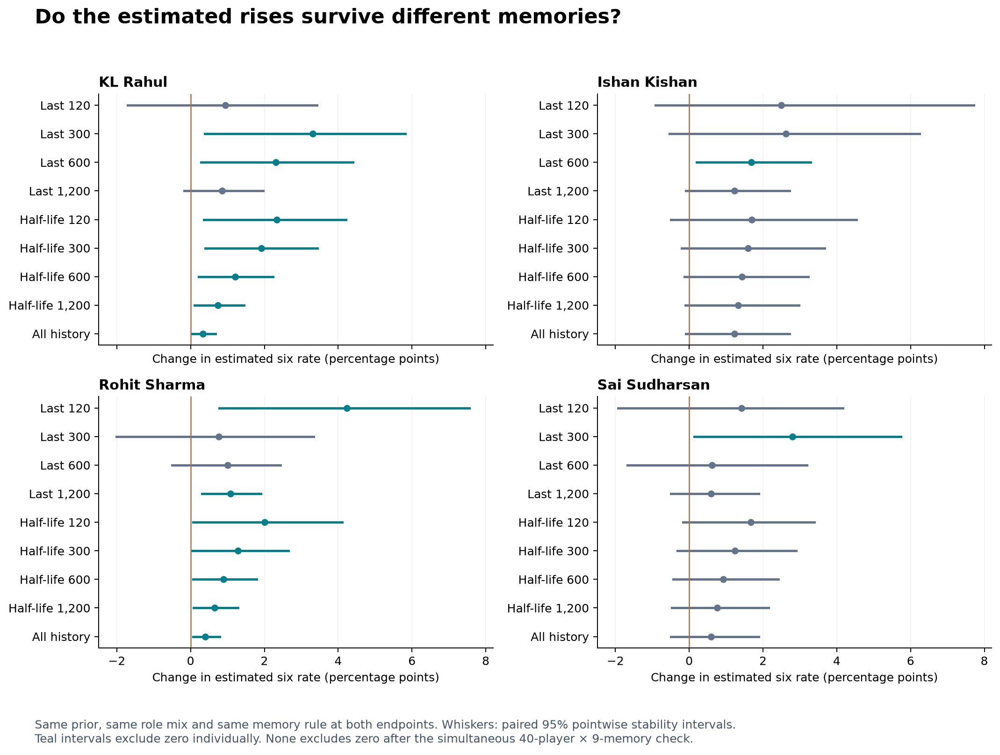

# Qualifying individual improvement with shrinkage and memory length

14 October 2026. This follow-up asks whether the apparent 2026 improvements survive shrinkage and different histories. It does not choose a favourable memory rule separately for each player or replace the original forecasting backtests.

## Answer

**Rahul's case holds up best at the project's previously selected 300-ball memory. Rohit also has broadly positive model updates, but his estimated increase is much larger with a short window than with the 300-ball rule. Kishan's increase is positive under all nine main rules, yet imprecise under most. Sai Sudharsan remains tentative.**

All four have positive point estimates under every one of the nine primary rules. Rahul and Rohit each have seven positive pointwise intervals, while Kishan and Sai have one each. These are correlated sensitivity checks, not nine independent votes. No player-memory change clears the simultaneous uncertainty band covering all 40 players and nine rules. The earlier context-adjusted audit also remains inconclusive.

## A fair before-and-after comparison

The starting estimate uses only data before 2026-03-28. The ending estimate includes data through 31 May 2026. For each row, we keep **the same memory rule, same pre-2026 population prior and same role mixture** on both sides. All priors are fitted on 2023–2025; no 2026 outcome is used to fit them.

We hold actual 2026 role exposure fixed to compare like with like. This is retrospective standardisation, not a preseason forecast that knew the future batting order. Positions 1–2 remain combined; 3–7 are separate. A memory means that player's last balls in that role, not their last balls across all roles.

This is different from comparing a recent rate against a career average: that comparison changes both the date and the estimator. It can exaggerate apparent change. It is also different from the previously published 2027 forecasts, which use a later population prior; the controlled comparisons here deliberately freeze the 2026 prior.

## The 300-ball rule already selected in the main project

The original project selected 300 balls on 2024 next-innings performance. Keeping that anchor avoids choosing a new memory length because it gives a preferred player result.

| Player | Before 2026 | After 2026 | Change | 95% pointwise stability interval |
| --- | --- | --- | --- | --- |
| KL Rahul | 5.05% | 8.36% | +3.31 pp | +0.38 to +5.82 pp |
| Ishan Kishan | 6.94% | 9.57% | +2.63 pp | -0.53 to +6.25 pp |
| Rohit Sharma | 7.34% | 8.11% | +0.76 pp | -2.00 to +3.33 pp |
| Sai Sudharsan | 3.78% | 6.58% | +2.80 pp | +0.13 to +5.74 pp |

These are changes in estimated probabilities, not reductions in log loss. For example, Rahul rises from about 5.1 to 8.4 expected sixes per 100 balls under this fixed model. His pointwise interval excludes zero, but the simultaneous player/window interval does not. Rohit's +0.76-point change at this rule is less decisive than his much larger short-window change.

## Sensitivity across memory lengths

All changes below are percentage points. Exponential half-life 300 means an observation 300 same-role balls old gets half the newest observation's weight. Every estimate uses empirical-Bayes shrinkage.

| Player | Last 120 | Last 300 | Last 600 | Last 1,200 | 300-ball half-life | All history | Positive pointwise intervals |
| --- | --- | --- | --- | --- | --- | --- | --- |
| KL Rahul | +0.94 | +3.31 | +2.31 | +0.85 | +1.92 | +0.33 | 7/9 |
| Ishan Kishan | +2.49 | +2.63 | +1.69 | +1.22 | +1.59 | +1.22 | 1/9 |
| Rohit Sharma | +4.23 | +0.76 | +1.01 | +1.08 | +1.29 | +0.40 | 7/9 |
| Sai Sudharsan | +1.41 | +2.80 | +0.62 | +0.59 | +1.24 | +0.59 | 1/9 |

The full data also include half-lives 120, 600 and 1,200. The 30-ball rule is a separately labelled stress check, not one of the nine main methods. Kishan's last-30-ball point estimate does not change at all; this is another reason not to call him positive under literally every tested rule.

Long-history estimates move less because new observations form a smaller fraction of their evidence. A +0.3-point full-history update and +3.3-point rolling update are different model responses, not two direct measurements of a true ability change.

## What changes in the player interpretation?

**KL Rahul:** positive under all nine primary rules. The last-300 and last-600 changes are +3.31 and +2.31 points; a 300-ball half-life gives +1.92. His last-120 change is only +0.94 and uncertain, so the evidence is not simply a late hot streak. Seven pointwise intervals exclude zero. This reinforces him as a promising candidate, while the original context-adjusted interval and simultaneous screen prevent a confirmed-ability claim.

**Rohit Sharma:** also positive under all nine, with seven pointwise intervals excluding zero. But the magnitude depends substantially on memory: +4.23 points at 120 balls versus +0.76 at 300 and +1.01 at 600. The 300-ball interval crosses zero. His recent estimated level rose, but the size of the apparent change is sensitive to where the window begins, and his 2026 sample is only nine innings.

**Ishan Kishan:** all nine primary changes are positive, ranging from +1.22 to +2.63 points. This is stable in direction, but only the 600-ball pointwise interval excludes zero. The 300-ball interval is −0.53 to +6.25 points. His No. 3 role is held fixed in this comparison, which helps, but older same-role evidence is limited and conditions are not fully controlled. Keep him on the candidate list without calling the improvement established.

**Sai Sudharsan:** positive direction across nine methods, but only the 300-ball pointwise interval excludes zero. The estimated increase shrinks from +2.80 at 300 balls to +0.62 at 600. This sensitivity, together with his weaker second half in the previous audit, keeps the case tentative.

## How much does shrinkage damp the season rates?

For this table alone, use only each player's 2026 record and apply the common pre-2026 role prior. This isolates the shrinkage operation from changing the memory window.

| Player | Raw 2026 rate | 2026-only rate after shrinkage |
| --- | --- | --- |
| KL Rahul | 9.14% | 8.53% |
| Ishan Kishan | 9.70% | 9.36% |
| Rohit Sharma | 11.73% | 9.88% |
| Sai Sudharsan | 6.61% | 6.55% |
| Rajat Patidar | 16.22% | 13.07% |
| Nitish Kumar Reddy | 11.93% | 9.19% |

Shrinking a seasonal record is not the same as taking the last 300 balls. The latter may include previous-season balls or omit early current-season balls, depending on the player's exposure in each role.

**Rajat Patidar:** the 2026 seasonal estimate falls from 16.2% raw to 13.1% after shrinkage. All nine matched-memory changes are positive, but none of their pointwise change intervals excludes zero. His year-only shrunk comparison does have a positive pointwise interval; its baseline is the poor 2025 season. His earlier 14.8% raw rate in 2024 still makes a rebound an important alternative to newly acquired ability.

**Nitish Kumar Reddy:** the seasonal estimate falls from 11.9% to 9.2%. Matched-memory changes are only about +1.1 to +1.3 points and all pointwise intervals cross zero. His role shifted substantially: most 2025 balls were at No. 4, whereas most 2026 balls were at Nos. 5–6. Comparing his aggregate 2.6% in 2025 directly with 11.9% in 2026 overstates the strength of a like-for-like improvement case.

## An informative counterexample: Rahane

Rahane also has positive point estimates under all nine rules, with seven positive pointwise intervals. This does not justify overturning the earlier observation that his aggregate 2026 rate was slightly below 2025. In 2025 he batted at No. 3 in this dataset; in 2026, 226 of 248 eligible balls were as an opener. The fixed-2026-role comparison draws heavily on an older opening record. A higher role-specific estimate relative to that older history is different from an overall year-on-year improvement. Ball-based memory can reach back across long gaps in that role. Role-level dates and sample sizes are exported to make this visible.

This example is why consistency across windows alone cannot identify genuine improvement.

## Uncertainty and limits

The analysis uses 1,000 shared population-player reweightings, fitting six pre-2026 role priors each time, and resamples each player's innings within season. The same resampled innings and same prior draw are used for both endpoints and all windows, preserving their overlap. Rolling/decay weights and role mixtures are held fixed. There are 26 bound-reaching prior fits out of 6,000; high prior strengths can be numerically weakly identified near complete pooling.

Pointwise intervals describe one fixed player-memory contrast. The approximate simultaneous band uses a maximum standardised bootstrap deviation across all 360 primary contrasts (critical multiplier 3.98). It is wider because we searched many correlated comparisons. **None has a positive simultaneous lower bound.** This is a conditional stability calculation, not proof of a permanent skill change or a fully joint Bayesian posterior. Population-prior and personal-innings resampling are an approximation, and the bands do not remove all observational confounding.

These simple shrunk estimates adjust roles, not venue, phase, opposition or health. The previous context-adjusted audit remains relevant and found no clearly positive adjusted 95% change interval. There is no contradiction: a conditional model estimate can rise consistently under resampling without establishing an independent change in ability.

## Reproduce and inspect

Run `python -m sixes.player_memory`, `python -m sixes.player_memory_verify`, then `python -m sixes.player_memory_report`. The earlier experiments and player audit remain unchanged. The current test suite passes 44 tests, including future exclusion, matched-memory endpoints and the simultaneous-band calculation.

- [Protocol](PLAYER_MEMORY_PROTOCOL.md)
- [All 440 player-memory comparisons](../results/player_memory/memory_changes.csv)
- [All 40 player summaries](../results/player_memory/player_summary.csv)
- [Role-specific counts, last historical dates and prior strengths](../results/player_memory/role_details.csv)
- [Frozen priors](../results/player_memory/fixed_priors.csv)
- [Analysis audit and assumptions](../results/player_memory/audit.json)
- [Independent reconstruction checks](../reports/player_memory_verification.json)
- [Earlier context-adjusted player audit](PLAYER_IMPROVEMENT_REPORT.md)
