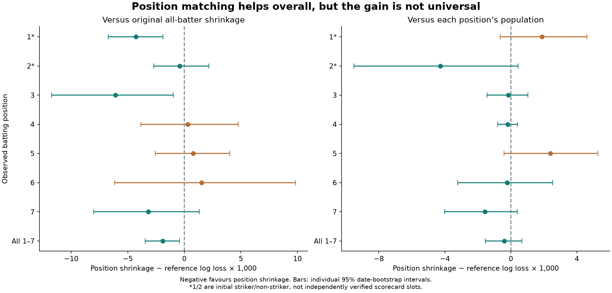
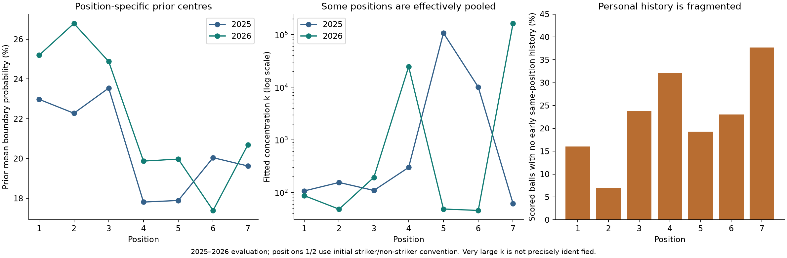

# Position-specific shrinkage: batting positions 1–7

**Experiment 1 extension · 13 October 2026 · exploratory**

## Answer

**Separate batting-position priors improve delivery-weighted log loss by 0.35% over the original all-batter shrinkage model on identical 2025–2026 late-half deliveries.** The effect is uneven: positions 1, 2, 3 and 7 have better point scores; 4, 5 and 6 have worse ones. Position 2's improvement over the original is tiny and it does not beat the shared 1–7 shrinkage benchmark.

**There is still little evidence that individual shrinkage beats simply using each position's population rate.** Its aggregate point improvement is only 0.074%, with a bootstrap interval crossing zero. None of the seven position-specific shrinkage-versus-population intervals excludes zero, even before simultaneous adjustment. Better role centring is useful, but seven completely separate personal histories are not a universally superior replacement.



## What each separate database means

There is one early-half player record for each **season × position × player ID**. A player batting at 3 and 5 has distinct records; only their early position-3 outcomes update their position-3 prior. Each prior uses all early players at that position, regardless of later appearances. Its strength is estimated by the same beta-binomial marginal likelihood as the original study. No strength is forced wider and no new model is chosen using the evaluation results.

The target is every eligible delivery faced at positions 1–7, not every batter assigned a permanent career label. Positions 8+ are excluded, and the original models are rescored on this exact 1–7 target. A separate shared-1–7 benchmark excludes the same tail positions but fits one prior and combines a player's history across ranks 1–7. It controls for the simpler effect of excluding lower-order records.

**Positions 1 and 2 need a qualification.** Cricsheet identifies the initial batter and non-striker; the pipeline calls these 1 and 2. It does not supply an independently validated scorecard opening order. Consequently these two results concern initial striker/non-striker, not different specialist opening roles. Ranks 3–7 are subsequent observed arrivals. Positions are reconstructed from every raw event before excluding illegal deliveries, including players first appearing as non-strikers. The two openers are also combined in a prespecified sensitivity analysis.

Predictions use the original calendar-half cutoffs, shared across all players and positions. They stay fixed for the late half. The outcome remains a batter boundary on a legal delivery outside Super Overs; legal byes/leg-byes remain zero outcomes and non-boundary flags are respected. Evaluation is **conditional on the observed later position**. We do not claim to know batting order at the midpoint or to forecast a player's probability of appearing at that position.

## Sample and aggregate results

The full positions-1–7 sample contains **267,994 eligible deliveries** across 2008–2026, versus 284,465 in the original all-position sample. The main evaluation has **12,881 late-half deliveries, 124 distinct players, 318 player-season-position records, 759 batter-innings and 54 match dates** across 2025–2026. Every model in each comparison scores the same outcomes.

| Model | Log loss ↓ | Brier ↓ | Equal-player log loss ↓ |
| --- | --- | --- | --- |
| Position-specific shrinkage | 0.541938 | 0.178299 | 0.528649 |
| Position population | 0.542338 | 0.178470 | 0.529347 |
| Original all-batter shrinkage | 0.543855 | 0.178891 | 0.528420 |
| Shared positions 1–7 shrinkage | 0.543144 | 0.178688 | 0.528050 |
| Raw player-position rate | 0.623781 | 0.181533 | 0.755011 |
| Smoothed player-position rate | 0.548725 | 0.180238 | 0.535698 |
| Leave-one-player-out shrinkage | 0.541976 | 0.178304 | 0.528807 |

Lower is better. Relative loss reductions are not percentage-point changes in boundary probability or accuracy. The equal-player metric aggregates each player's losses over positions/seasons before giving each player equal weight. It **slightly favours the original and shared-1–7 shrinkage models**, unlike the delivery-weighted result. Do not claim improvement for every weighting convention.

The shrinkage-minus-reference paired log-loss differences are:

| Reference | Difference | 95% low | 95% high |
| --- | --- | --- | --- |
| Position population | -0.000400 | -0.001555 | 0.000672 |
| Raw player-position rate | -0.081844 | -0.121909 | -0.046848 |
| Original all-batter shrinkage | -0.001917 | -0.003464 | -0.000426 |
| Smoothed player-position rate | -0.006787 | -0.009409 | -0.004291 |
| Shared positions 1–7 shrinkage | -0.001207 | -0.002676 | 0.000218 |

The shared-1–7 comparison is especially useful: the point gain over it is smaller and its interval crosses zero. Therefore the 0.35% gain over the original model cannot be attributed wholly and confidently to seven-way separation rather than the changed training population.

Paired uncertainty uses 2,000 whole-date resamples within evaluation season. Each resample uses common dates across positions so the aggregate retains same-day dependence. These intervals condition on fitted priors and observed exposures, omit refitting and some player/time dependence, and do not establish causal or permanent skill differences.

## Results at each position

These are log losses on each position's own identical target. Different positions have different boundary frequencies, so compare methods within a row, not absolute losses across rows.

| Position | Late balls | Position population | Raw | Position shrinkage | Original shrinkage | Shared 1–7 shrinkage |
| --- | --- | --- | --- | --- | --- | --- |
| 1 | 2,405 | 0.578526 | 0.656551 | 0.580415 | 0.584696 | 0.583513 |
| 2 | 2,570 | 0.569623 | 0.567220 | 0.565349 | 0.565746 | 0.565253 |
| 3 | 2,315 | 0.540300 | 0.542978 | 0.540148 | 0.546224 | 0.544961 |
| 4 | 2,111 | 0.527304 | 0.581825 | 0.527108 | 0.526802 | 0.526114 |
| 5 | 1,535 | 0.489096 | 0.772003 | 0.491494 | 0.490698 | 0.490876 |
| 6 | 1,064 | 0.516241 | 0.681285 | 0.516018 | 0.514493 | 0.514326 |
| 7 | 881 | 0.529609 | 0.684481 | 0.528034 | 0.531219 | 0.530355 |

The largest point gain over the original shrinkage model is at position 3. Positions 4–6 show why an aggregate gain should not be used to impose the same modelling choice everywhere. The raw-rate failures are more severe when small histories are fragmented across positions.

For the individualisation question, uncertainty is:

| Position | Shrinkage minus population | Individual low | Individual high | Simultaneous low | Simultaneous high |
| --- | --- | --- | --- | --- | --- |
| 1 | 0.001890 | -0.000638 | 0.004613 | -0.003087 | 0.006866 |
| 2 | -0.004274 | -0.009517 | 0.000435 | -0.009251 | 0.000702 |
| 3 | -0.000152 | -0.001440 | 0.001028 | -0.005129 | 0.004824 |
| 4 | -0.000196 | -0.000792 | 0.000410 | -0.005172 | 0.004780 |
| 5 | 0.002398 | -0.000424 | 0.005265 | -0.002578 | 0.007374 |
| 6 | -0.000222 | -0.003221 | 0.002533 | -0.005199 | 0.004754 |
| 7 | -0.001575 | -0.004007 | 0.000379 | -0.006551 | 0.003401 |

The simultaneous columns use the 95th percentile of the maximum absolute centred bootstrap deviation across the seven effects, producing an approximate common-width family band. This is not a multiplicity correction for every exploratory model/scenario. None of the seven differences establishes a win over its own position population under either displayed interval.

## Prior centres, strengths and lost personal history

| Season | Position | Early players | Early balls | Prior mean | k | Prior SD | At bound |
| --- | --- | --- | --- | --- | --- | --- | --- |
| 2025 | 1 | 20 | 1622 | 22.98% | 106.7 | 4.05 pp | False |
| 2025 | 2 | 23 | 2021 | 22.28% | 154.6 | 3.34 pp | False |
| 2025 | 3 | 21 | 1705 | 23.54% | 109.0 | 4.05 pp | False |
| 2025 | 4 | 33 | 1619 | 17.81% | 298.6 | 2.21 pp | False |
| 2025 | 5 | 35 | 1255 | 17.89% | 107,165.0 | 0.12 pp | False |
| 2025 | 6 | 34 | 878 | 20.04% | 10,087.3 | 0.40 pp | False |
| 2025 | 7 | 31 | 573 | 19.63% | 61.6 | 5.02 pp | False |
| 2026 | 1 | 20 | 1565 | 25.19% | 86.8 | 4.63 pp | False |
| 2026 | 2 | 23 | 1661 | 26.79% | 48.0 | 6.33 pp | False |
| 2026 | 3 | 20 | 1400 | 24.88% | 193.4 | 3.10 pp | False |
| 2026 | 4 | 26 | 1384 | 19.87% | 24,615.0 | 0.25 pp | False |
| 2026 | 5 | 29 | 1029 | 19.97% | 48.3 | 5.69 pp | False |
| 2026 | 6 | 32 | 871 | 17.39% | 45.4 | 5.56 pp | False |
| 2026 | 7 | 31 | 516 | 20.69% | 162,754.8 | 0.10 pp | True |

The prior mean differs materially by position. For example, in 2026 it is about 25–27% for the two opening slots and position 3, versus about 17–21% for positions 4–7. A common mean misses some of these contextual differences.

Concentration k is **not** the number of early balls in the group. The individual-data weight is N/(N+k). Several groups have extremely large fitted k and forecasts close to their position population. In the primary fit, 2026 position 7 reaches the upper bound; 2025 positions 5/6 and 2026 position 4 are also effectively pooled. These values should be read as little detectable between-player heterogeneity under this model, not as precisely measured concentrations or proof of identical abilities.

As a numerical diagnostic, replacing all evaluation fits with k >= 10,000 by their exact pooled-probability limit changes aggregate log loss from 0.541938 to **0.541943**. This is a post-fit numerical check, not a tuned replacement model. The headline interpretation is unchanged. Bounds for all scenarios and all original fit flags remain in the published tables; no all-batter fallback was needed for insufficient position cohorts.



| Position | Late balls | No same-position history | Share | History at other positions only |
| --- | --- | --- | --- | --- |
| 1.000000 | 2405.000000 | 386.000000 | 16.0% | 301.000000 |
| 2.000000 | 2570.000000 | 180.000000 | 7.0% | 31.000000 |
| 3.000000 | 2315.000000 | 550.000000 | 23.8% | 389.000000 |
| 4.000000 | 2111.000000 | 679.000000 | 32.2% | 616.000000 |
| 5.000000 | 1535.000000 | 296.000000 | 19.3% | 254.000000 |
| 6.000000 | 1064.000000 | 245.000000 | 23.0% | 199.000000 |
| 7.000000 | 881.000000 | 332.000000 | 37.7% | 258.000000 |

Overall, **2,668 of 12,881 deliveries (20.7%)** are faced by players with no early-half history at that exact position. **2,048** of those deliveries belong to players with early batting history somewhere else. Their main position forecast discards that personal evidence and uses the position prior. Late-only population fallback is correct for the requested independent-database design, but the lost evidence is a reason to consider partial pooling later.

## Is the effect the prior centre, concentration or personal history?

The following calculations all keep the player's same-position early counts fixed:

| Diagnostic | Log loss | Brier |
| --- | --- | --- |
| All-batter prior + position history | 0.542943 | 0.178627 |
| All-batter mean + position strength | 0.542585 | 0.178521 |
| Position mean + all-batter strength | 0.542221 | 0.178384 |
| Position-specific shrinkage | 0.541938 | 0.178299 |
| Position prior mean, no update | 0.542412 | 0.178495 |

Both centre and concentration affect the result; the improvement is not evidence that weaker shrinkage is desirable. Updating an all-batter prior with position-only history already changes performance relative to the original all-role personal history. The position prior then adds a smaller gain whose paired interval marginally crosses zero. A leave-one-player-out prior scores 0.541976, close to the primary 0.541938; reusing a player's early record in the empirical prior is not driving the headline result.

## Robustness and limits

**Combining the opening pair:** keeping ranks 3–7 separate but merging 1/2 gives aggregate log loss 0.541847, slightly better than the requested seven-way split's 0.541938. The paired combined-minus-separate difference is -0.000091, interval [-0.000313, 0.000129]. There is no convincing additional benefit from the source's 1/2 convention. The merged-opening component reproduces the previous opener experiment exactly.

**Match-count halves:** a shared date cutoff nearest half the season's matches gives 15,952 evaluation deliveries. Position shrinkage scores 0.535477 versus 0.536679 for the correspondingly refitted all-batter reference, and 0.535903 for position pooling. Direction is similar, but the respective difference intervals [-0.002842, 0.000263] and [-0.001525, 0.000544] cross zero. Absolute scores cannot be compared to the calendar split because the scored balls differ.

**Minimum 11 early and late opportunities at the same position:** 9,059 balls remain. This is a retrospective evaluation subset, never a training filter.

| Model | Log loss ↓ | Brier ↓ | Equal-player log loss ↓ |
| --- | --- | --- | --- |
| Position-specific shrinkage | 0.545504 | 0.179925 | 0.529699 |
| Position population | 0.546269 | 0.180235 | 0.531642 |
| Original all-batter shrinkage | 0.545785 | 0.179997 | 0.529224 |
| Shared positions 1–7 shrinkage | 0.545463 | 0.179904 | 0.528985 |
| Raw player-position rate | 0.552499 | 0.181587 | 0.537770 |
| Smoothed player-position rate | 0.551014 | 0.181428 | 0.535920 |

On this subset, shrinkage still clearly beats raw rates, but its advantage over original shrinkage is only -0.000281, interval [-0.001339, 0.000789]; shared-1–7 shrinkage has a slightly better point score. The very large all-sample raw log-loss penalty depends on raw zero/one probabilities and the fixed 10^-6 clip. The smoothed-rate and restricted checks show that shrinkage's advantage over naive personal rates is not solely this numerical effect. Brier is always computed without clipping.

**Season stability:**

| Season | Model | Log loss | Brier |
| --- | --- | --- | --- |
| 2024 | Position-specific shrinkage | 0.525172 | 0.170541 |
| 2024 | Original all-batter shrinkage | 0.523451 | 0.170020 |
| 2024 | Position population | 0.525006 | 0.170607 |
| 2024 | Shared positions 1–7 shrinkage | 0.522944 | 0.169881 |
| 2025 | Position-specific shrinkage | 0.546615 | 0.180296 |
| 2025 | Original all-batter shrinkage | 0.548755 | 0.180943 |
| 2025 | Position population | 0.547269 | 0.180533 |
| 2025 | Shared positions 1–7 shrinkage | 0.547673 | 0.180626 |
| 2026 | Position-specific shrinkage | 0.538125 | 0.176671 |
| 2026 | Original all-batter shrinkage | 0.539861 | 0.177218 |
| 2026 | Position population | 0.538318 | 0.176789 |
| 2026 | Shared positions 1–7 shrinkage | 0.539453 | 0.177110 |

The seven-way split beats original shrinkage in both 2025 and 2026, but loses in 2024 (0.525172 versus 0.523451) and across development years (0.454032 versus 0.453601). These earlier losses, equal-player reversal and match-count uncertainty prevent a universal improvement claim.

## Real-player examples

The following 2026 cases were chosen after analysis to illustrate role changes, not as extra validation. A player can have several simultaneous position forecasts. “No history” means no eligible early-half ball at that position, not no IPL experience.

| Player | Position | Early balls | Raw early rate | Position population | Position shrinkage | Original shrinkage | Late balls |
| --- | --- | --- | --- | --- | --- | --- | --- |
| HH Pandya | 6 | 18 | 5.6% | 17.5% | 14.0% | 21.3% | 50 |
| HH Pandya | 7 | 0 | No history | 20.7% | 20.7% | 21.3% | 15 |
| KL Rahul | 1 | 4 | 0.0% | 25.5% | 24.1% | 27.0% | 8 |
| KL Rahul | 2 | 188 | 29.3% | 26.8% | 28.8% | 27.0% | 139 |
| SV Samson | 1 | 177 | 26.6% | 25.5% | 26.1% | 25.3% | 108 |

## What this supports next

Keep position-matched population rates as strong benchmarks. Test **role-centred priors with partial sharing of personal history**, rather than automatically discarding all other-position records. Combine the opening pair unless independent position labels or prospective evidence justify separating them. Investigate why positions 4–6 do not benefit before replacing their existing forecasts. Continue to distinguish role/phase/environment effects from individual form.

This report does not implement those suggestions. The original sequential, preseason, context and 2027 watchlist experiments, previous opener results and earlier future-work plan are all unchanged. This extension was motivated by previously inspected outcomes: 2025–2026 remain exploratory, not newly untouched confirmation. No model is selected separately for each position from these results.

## Reproduction and verification

```bash
python pipeline.py  # only if processed data are missing
python positions_experiment.py
python build_positions_report.py
python verify_positions.py
python -m pytest -q
```

Use the repository's existing dependency environment. The new commands never invoke later experiments. Machine-readable outputs are in [results/positions](../results/positions), including wide forecasts (one probability column per model), priors, per-position/per-season metrics, raw coverage, cold starts, calibration, individual/simultaneous uncertainty and numerical checks. In priors, -1 denotes the original all-batter prior, -2 the shared-1–7 prior, and 0 the combined-opening group in its sensitivity. Prediction groups contain no negative ranks.

[The protocol](POSITIONS_PROTOCOL.md) and [configuration](../config/positions_protocol.json) record scope and timing. [Verification](../reports/positions_verification.json) independently rebuilds eligible innings counts and positions from the pinned raw JSON, reconstructs forecasts and losses, checks prior references against earlier committed studies, and checks hashes for every previously tracked research artifact except the additive README index. The initial local protocol commit preceded fitting; a shared-1–7 control was added before inspecting new performance, and the near-pooling numerical approximation was added after fitting and labelled accordingly.

The outcome is boundary probability, not overall batting quality, dismissal risk or selection probability. Later batting positions and innings survival have different context mixes; their fitted distributions do not isolate causal ability. Source data are the same retrospective [Cricsheet](https://cricsheet.org/) archive through 31 May 2026, with [the repository's attribution](../DATA_LICENSE.md).
