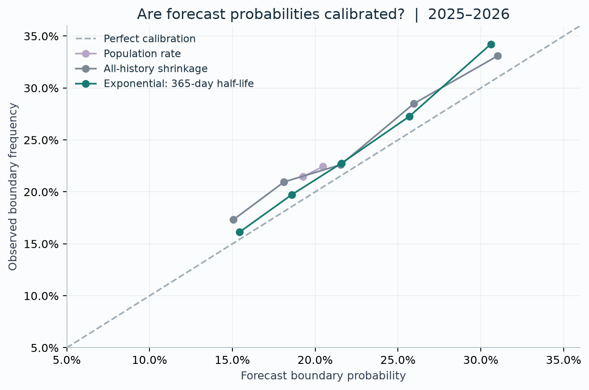
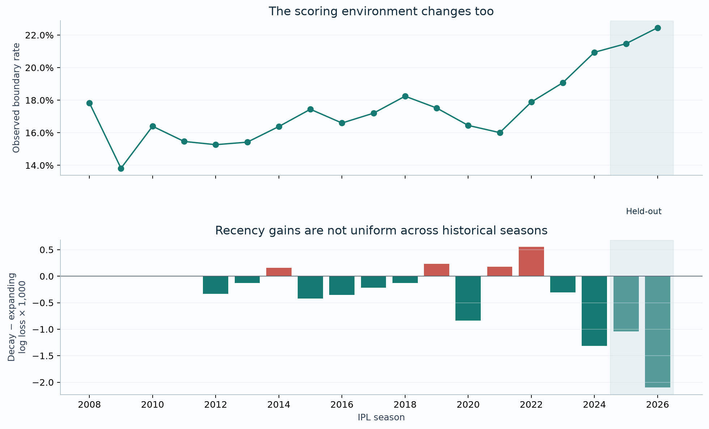
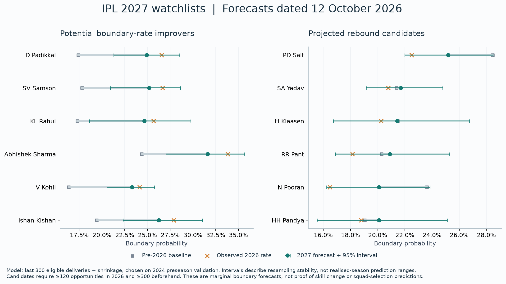
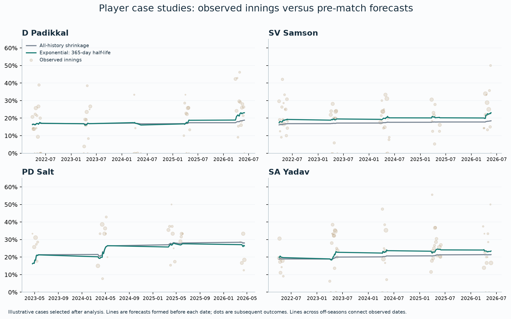

# How quickly should we believe a batter has improved?

**A reproducible IPL boundary-forecasting study · Kashyap Karthik · 12 October 2026**

## Findings

Remembering less history improves simple forecasts, but this is not sufficient evidence of genuine skill improvement. A 365-day exponential half-life, chosen on 2024, reduces delivery-weighted log loss by **0.30%** relative to all-history shrinkage on 2025–2026. Its extra value after contextual adjustment is small and statistically indistinguishable from zero under our bootstrap. The project therefore supports a forecasting improvement, with a qualified interpretation of “form”.

- **Shrinkage:** beta-binomial forecasts improve on raw early-season player rates. The gain over a pooled population rate is uncertain.
- **Memory during a season:** recent weighting helps in the reserved seasons, but not uniformly in earlier seasons or for every player-weighting scheme.
- **Memory across an off-season:** 2024 selects a 300-ball rolling window for forecasts frozen before a season. It reduces test log loss by 0.24% versus expanding history. We retain that selected model even though another candidate scores slightly better on the test set.
- **Context:** adding recent-history information to a past-trained contextual model yields a log-loss difference of -0.000047, with a 95% interval [-0.000203, 0.000102]. This does not establish extra predictive value after adjustment.
- **Application:** dated 2027 forecasts for 175 batters who faced an eligible ball in 2026, with two candidate watchlists. They forecast one aspect of batting, not overall quality or likelihood of selection.

## 1. Question and relation to Brown

Brown (2008) used early-season baseball records to forecast later batting averages and compared shrinkage estimators with naïve estimates. This study adapts that prediction question to a binary cricket outcome. It uses a beta-binomial estimator rather than reproducing Brown's complete transformed-normal estimator suite. Brown also examined streakiness; this project does not claim to introduce that question. Its particular extension compares history lengths and decay rules across IPL seasons.

An exact reproduction of Brown's numerical baseball results is outside this study. An arcsine noise-adjusted score on the ≥11-opportunity subset provides a methodological connection, not an estimator replication.

## 2. Data and outcome

The pinned Cricsheet archive contains **1,243 matches**, **295,732 delivery events**, and seasons **2008–2026**. Source coverage ends **31 May 2026**. The primary sample has **284,465 eligible deliveries**, including **49,905 boundaries**, aggregated into **18,760 batter-innings**. This is a current retrospective data vintage, not a reconstruction of each past publication date. Coverage has not been independently matched to every official scorecard.

A success is a four or six credited to the batter, unless marked `non_boundary`. Eligible opportunities are legal deliveries outside Super Overs. We retain ordinary legal byes/leg-byes as zero outcomes and preserve all excluded events in the raw layer. The exclusion accounting is 175 Super Over events + 9,871 ordinary wides + 1,221 ordinary no-balls. There are 29 raw fours/sixes marked non-boundary. We call the denominator eligible deliveries, not official scorecard balls faced.

Player identities come from Cricsheet registry IDs. Match/innings/event order prevents illegal-ball numbering errors. Dates normalise IPL season labels while preserving source labels. Wickets, rosters, substitutions, venue, opposition, nominal innings phase, and pre-delivery state remain available. Venue groups conservatively merge punctuation and city suffixes; major renamed/rebuilt venue labels remain distinct. The mapping is published in `results/venue_mapping.csv`.

Shortened and no-result innings with observed balls remain in the main sample. A standard-conditions sensitivity check removes documented shortened/miscounted cases. Nominal phases are overs 1–6, 7–15 and 16–20; they do not claim exact fielding restrictions in rain-shortened matches. Final chase targets and match winners are not forecast features. Batting-entry order is observed order, not an externally validated specialist role.

## 3. Model

For each player, B boundaries in N opportunities are modelled as binomial with unknown probability p, with a Beta(alpha, beta) population prior. The posterior mean is:

`forecast = (alpha + B) / (alpha + beta + N)`

Equivalently, the forecast averages the player's rate and the population mean. The weight on the player's rate is `N / (N + alpha + beta)`. Small samples receive stronger shrinkage. SciPy maximises the beta-binomial marginal likelihood over population mean and concentration, using multiple starting values and bounded optimisation.

In the within-season adaptation, population parameters use early-half players only. In the multi-season experiments, the prior for year t is fitted to player-season counts in years t−3 through t−1. The same annual prior is used for every history method. Repeated players mean those population records are not fully independent; the model is an approximation. No current-year outcomes enter that year's prior fit.

The expanding model uses all earlier IPL balls equally. Rolling models use the latest 120, 300, 600 or 1,200 opportunities. Exponential models use ball half-lives of 120/300/600/1,200 or calendar half-lives of 90/180/365/730 days. Weighted counts enter the same forecast equation. These are discounted-count forecasting rules, not automatically exact conjugate posteriors. Calendar decay reduces evidence during an off-season and increases shrinkage towards the population prior; ball decay does not decay through inactivity.

## 4. Experimental design and leakage controls

The protocol and grid were committed before model results were inspected. Development years run through 2023; 2024 selects candidates by delivery-weighted log loss; 2025–2026 evaluate the frozen choices. The snapshot counts were already inspected during data preparation. This is an internal analysis freeze, not external preregistration.

**Within season:** one calendar midpoint per season separates early and late halves. All forecasts freeze at the cutoff. New late-half batters receive a population forecast. Tables show both all late-half players and the subset with at least 11 opportunities in each half. The latter is a retrospectively defined comparable evaluation subset, not a deployable selection rule. Calendar halves are unusual in the interrupted 2021 season; our numerical claims focus on 2025–2026. IPL playoffs are included, unlike Brown's baseball regular-season restriction.

**Sequential:** form one forecast per batter before each match date and keep it fixed through that innings. All same-date outcomes are excluded from its historical features. Once outcomes occur, they can enter later forecasts under the frozen rule, including during the test seasons.

**Preseason:** freeze probabilities before the first observed match of the target season. Evaluate these unchanged forecasts on every later opportunity. This directly tests persistence over the off-season. New players have no invented history and receive the prior. Metrics are conditional on actual batting exposure; selection and opportunity volume are not forecast.

**Context:** fit regularised logistic models using the preceding five seasons, then predict the next season's deliveries. Features include historical expanding ability, venue group, opposition team, nominal phase, innings, observed batting-entry order, score/wickets/balls before delivery, and a season trend. Compare adding the pre-date recent-minus-expanding logit signal. Encoders and scalers use training data only. Context forecasts have a richer pre-delivery information set than the pre-innings main forecasts; their absolute scores are not a like-for-like model contest with the main table. Opposition is team-level, not an estimated bowler-strength model.

Log loss and Brier score reward well-calibrated probabilities. Scores are reported both per delivery and with equal weight per player. Raw zero/one rates are clipped to 10^-6 only for numerical log loss; their poor scores can be sensitive to this choice. We therefore show Brier score, sample-restricted results and population comparisons too.

Paired loss differences use 2,000 date-block bootstrap resamples within each test season. These intervals condition on fitted models and two observed seasons. They do not capture every serial dependence, retraining uncertainty, model-selection uncertainty or future regime shift. Subgroup results are descriptive, without multiple-comparison claims.

## 5. Within-season adaptation

Held-out 2025–2026, at least 11 opportunities in each half (12,270 late-half deliveries):

| Model | Log loss ↓ | Brier score ↓ | Equal-player log loss ↓ |
| --- | --- | --- | --- |
| Beta-binomial shrinkage | 0.541251 | 0.177772 | 0.520442 |
| Population rate | 0.541535 | 0.178002 | 0.521715 |
| Raw player rate | 0.548466 | 0.179630 | 0.532583 |

Across all late-half observations, the raw versus shrinkage comparison is more dramatic because tiny early samples can generate zero/one forecasts. The all-player beta-binomial versus population log-loss difference is −0.000388, with date-bootstrap interval [−0.002326, 0.001445]. **The data do not clearly establish that individualised shrinkage beats the population baseline at this horizon.**

A post-protocol sensitivity check replaces raw rates with a Jeffreys-smoothed individual estimate `(B + 0.5)/(N + 1)`, retaining the population fallback for no early history. Its all-player test log loss is 0.542938, versus 0.536012 for empirical Bayes; on the ≥11 subset it is 0.547034, versus 0.541251. Shrinkage's advantage is smaller than against clipped raw rates but remains in the point estimates. This additional diagnostic did not select the forecasting model.

The arcsine noise-adjusted mean squared error on the ≥11 subset is 0.002349 for beta-binomial versus 0.007329 for raw rates; this transformed score is approximate and only reported on the restricted subset. It is not a probability or a literal percentage of variance explained.

## 6. Which history is useful?

Sequential forecasts on 33,171 held-out deliveries:

| Model | Log loss ↓ | Brier score ↓ | Equal-player log loss ↓ |
| --- | --- | --- | --- |
| Current-season shrinkage | 0.525183 | 0.170898 | 0.447559 |
| Exponential: 300-ball half-life | 0.523988 | 0.170507 | 0.443615 |
| Exponential: 365-day half-life | 0.523852 | 0.170457 | 0.446350 |
| All-history shrinkage | 0.525423 | 0.170946 | 0.443832 |
| Population rate | 0.527694 | 0.171799 | 0.451486 |
| Raw all-history rate | 0.540324 | 0.171362 | 0.497255 |
| Last 300 balls + shrinkage | 0.524090 | 0.170531 | 0.443684 |

2024 selects **365-day exponential decay**. Relative to expanding shrinkage, its test log-loss difference is **-0.001571**, interval **[-0.002258, -0.000929]**. Its Brier improvement is consistent in sign. However, equal-player log loss is worse than expanding in this test: weighting every batter equally changes the answer. The chosen criterion emphasises players with more opportunities.

Preseason forecasts, scored on the same held-out opportunities:

| Model | Log loss ↓ | Brier score ↓ | Equal-player log loss ↓ |
| --- | --- | --- | --- |
| Current-season shrinkage | 0.529228 | 0.172279 | 0.449690 |
| Exponential: 300-ball half-life | 0.525776 | 0.171102 | 0.444899 |
| Exponential: 730-day half-life | 0.526011 | 0.171177 | 0.447028 |
| All-history shrinkage | 0.527164 | 0.171523 | 0.445059 |
| Population rate | 0.527694 | 0.171799 | 0.451486 |
| Raw all-history rate | 0.557174 | 0.172105 | 0.505161 |
| Last 300 balls + shrinkage | 0.525908 | 0.171131 | 0.445053 |

2024 selects **the last 300 balls**. Its test difference from expanding is **-0.001257**, interval **[-0.002081, -0.000439]**. The 300-ball exponential model has a slightly better realised test score, but switching to it now would use test outcomes to choose the method.

The reliability plot exposes calibration imperfections; recent weighting does not make the forecasts perfectly calibrated. Points use fixed probability bins and at least 200 opportunities; they are descriptive, without independent-ball confidence bars.

## 7. Does this identify genuine improvement?

The league's scoring environment changes materially. A whole-career average may lag a league-wide shift even if the player's relative skill has not changed. Context-adjusted log loss is 0.517997 with expanding ability and 0.517950 when the recency signal is added. The interval for that incremental change includes zero.

Recency's simple-model advantage varies by phase: log-loss differences versus expanding are −0.003938 in the powerplay, +0.000270 in the middle overs and −0.002069 at the death. Standard-conditions-only results retain the main advantage (−0.001633, interval [−0.002301, −0.000996]). Venue and opposition breakdowns are supplied as CSV, without treating small subgroups as definitive findings.

The supported conclusion is **better simple forecasts from recent weighting in these test seasons**. The study does **not** establish a general causal or permanent increase in individual batting skill. Context, role, opposition quality, league evolution and remaining unobserved factors can all matter. A null incremental result is part of the research finding, not a reason to suppress it.

## 8. Prospective IPL 2027 application

Forecasts were generated on **12 October 2026** using observations through the available 2026 season. The selected preseason model is rolling 300 balls with a prior refitted through 2026. For time-decay comparisons, 28 March 2027 is an explicit assumed reference date, not an announced schedule; the selected rolling forecast itself does not depend on that date.

Watchlist eligibility requires ≥120 eligible balls in 2026 and ≥300 before 2026. 43 players meet those history thresholds. An improver candidate has forecast boundary probability more than one percentage point above their pre-2026 shrunk historical baseline. A rebound candidate has an observed 2026 rate below baseline and a forecast above the observed 2026 rate. The labels can overlap because they answer different comparisons. A strong last-120-ball rate is provided as a separate descriptive column; candidate status does not require a strong finish.

**Potential boundary-rate improvers (largest projected changes):**

| Player | Pre-2026 baseline | Observed 2026 | 2027 forecast | Interval low | Interval high | Change vs baseline |
| --- | --- | --- | --- | --- | --- | --- |
| D Padikkal | 17.4% | 26.5% | 24.9% | 21.3% | 28.5% | +7.5 pp |
| SV Samson | 17.8% | 26.7% | 25.2% | 20.9% | 28.6% | +7.4 pp |
| KL Rahul | 17.3% | 25.7% | 24.6% | 18.6% | 29.7% | +7.4 pp |
| Abhishek Sharma | 24.4% | 33.8% | 31.6% | 27.0% | 35.7% | +7.2 pp |
| V Kohli | 16.3% | 24.1% | 23.3% | 20.5% | 25.8% | +7.0 pp |
| Ishan Kishan | 19.4% | 27.9% | 26.2% | 22.3% | 31.0% | +6.8 pp |
| SS Iyer | 16.7% | 23.5% | 23.3% | 18.6% | 26.6% | +6.6 pp |
| Shubman Gill | 17.7% | 23.8% | 24.1% | 20.2% | 27.6% | +6.4 pp |

**Projected rebound candidates (ranked by forecast rate):**

| Player | Pre-2026 baseline | Observed 2026 | 2027 forecast | Interval low | Interval high | Change vs baseline |
| --- | --- | --- | --- | --- | --- | --- |
| PD Salt | 28.5% | 22.5% | 25.2% | 22.0% | 28.5% | -3.3 pp |
| SA Yadav | 21.4% | 20.8% | 21.7% | 19.2% | 24.8% | +0.3 pp |
| H Klaasen | 21.5% | 20.3% | 21.4% | 16.7% | 26.7% | -0.0 pp |
| RR Pant | 20.3% | 18.1% | 20.9% | 16.9% | 25.3% | +0.6 pp |
| N Pooran | 23.6% | 16.5% | 20.1% | 16.2% | 23.8% | -3.5 pp |
| HH Pandya | 19.0% | 18.8% | 20.1% | 15.5% | 25.1% | +1.1 pp |
| C Green | 20.2% | 17.7% | 19.0% | 15.6% | 22.2% | -1.2 pp |
| RD Gaikwad | 18.0% | 14.7% | 16.1% | 13.1% | 18.7% | -1.9 pp |

Intervals use 1,000 season-stratified innings-block resamples, preserving original window membership/weights, and shared player-level Bayesian bootstrap weights to refit population priors. They describe conditional resampling stability of the estimate, not a prediction interval for realised 2027 outcomes. Baseline and forecast are resampled together, preserving their overlapping evidence. The population prior changes between baseline and forecast; the prior mean rises by 1.04 percentage points. Do not interpret the entire forecast-minus-baseline difference as player-specific improvement.

No injury, age, other-league form, expected team, availability or squad-selection model is included. These are marginal boundary-rate forecasts under an unspecified future context mix. Intervals are marginal across players, and no multiple-testing correction is applied. Bootstrap positive fractions are stability diagnostics, not posterior probabilities of true improvement. Realised 2027 outcomes remain unknown and must be evaluated later without rewriting the dated forecast.

In the complete forecast CSV, a player with no pre-2026 IPL observations has a population-only baseline, explicitly marked in `baseline_basis`; it is not an observed personal history. Such players cannot enter the history-qualified watchlists. Stability intervals can be artificially narrow when very few innings are available, another reason not to read them as full player-ability uncertainty.

## 9. Real-player illustrations

Cases are selected after analysis to illustrate contrasting histories. Lines are pre-match forecasts; dots are realised innings rates, with larger dots for more opportunities. A spectacular innings can be noisy, and a forecast responds only after it has happened. These charts explain the mechanism and are not additional independent validation.

## 10. Reproduce and inspect

See the repository README for one-command reproduction. `config/protocol.json` defines all grids, thresholds and seeds. Raw archive SHA-256: `5757e04287179767ff8495f02902bd13812b9572ec8fa2ac1347ec2e9c6d4709`. CSVs contain priors, candidate selection, metrics, loss differences, subgroups, calibration and every prospective forecast. Generated Parquet prediction tables are local intermediates. Tests check event accounting, leakage, exact history calculations, scoring and model recovery on simulated data.

Useful libraries: pandas and NumPy for chronological tables, SciPy for empirical Bayes estimation, scikit-learn for contextual models, Matplotlib for figures, and PyArrow for typed data storage. Computation was assisted by Codex; code, assumptions, limitations and generated results are exposed for scrutiny.

The connection to quantitative research is noisy signal estimation, shrinkage, choosing adaptation speeds, avoiding look-ahead bias and judging held-out evidence. No claim about profitable trading follows from cricket prediction scores.

## Sources

- [Brown (2008), In-season prediction of batting averages](https://www.stat.berkeley.edu/users/aldous/157/Papers/brown_batting.pdf), DOI 10.1214/07-AOAS138.
- [Cricsheet IPL data](https://cricsheet.org/downloads/), [JSON field definitions](https://cricsheet.org/format/json/), [licensing](https://cricsheet.org/licensing/).
- This study's [frozen protocol](PROTOCOL.md), [machine-readable configuration](../config/protocol.json), and [data attribution](../DATA_LICENSE.md).
