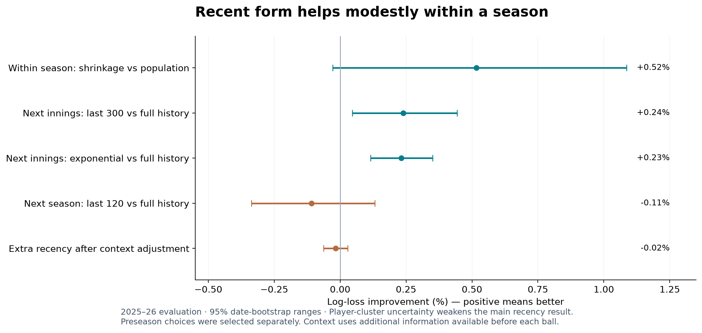
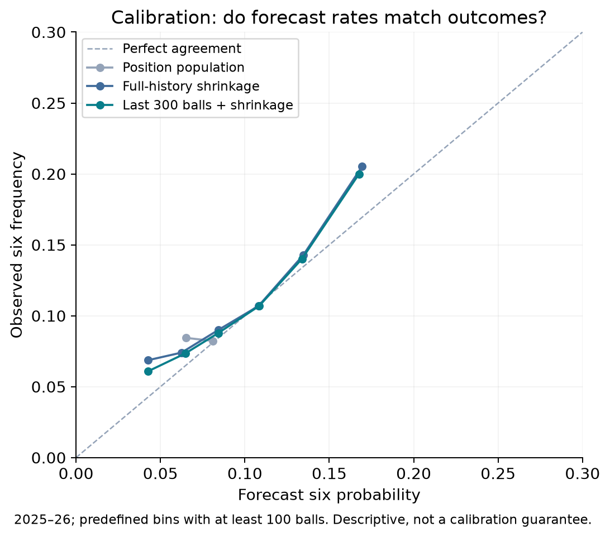
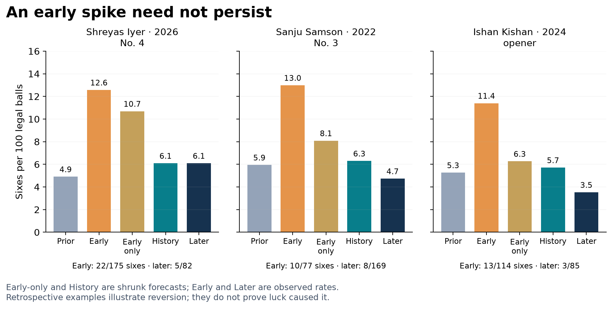
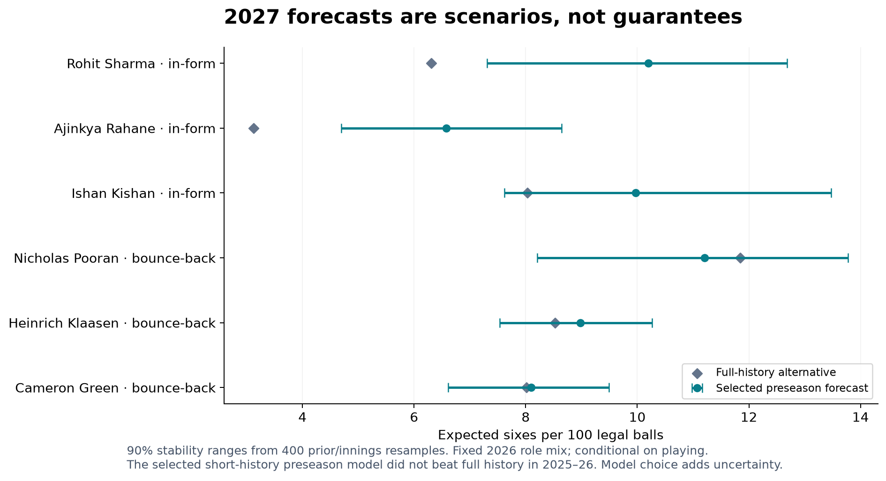

# How much should a six-rate forecast trust recent form?

**IPL forecasting project · Kashyap Karthik · 14 October 2026**

## The answer in one minute

**Recent performances contain some useful predictive information, but the gain is small and does not establish permanent improvement.** The model selected on 2024 uses the last **300 same-role balls plus empirical-Bayes shrinkage** for the next innings. On 2025–2026 it improves log loss by **0.24% over full-history shrinkage**, **1.03% over a position-population forecast**, and **11.21% over raw full-history rates**.

A very short 30-ball shrunk history and an unsmoothed recent rate perform worse. However, it is not true that *any* removal of old personal history must hurt: the selected rolling 300-ball model discards older personal observations and still improves. The fitted population prior continues to supply information from three earlier seasons. An exponential model that retains all earlier balls with decreasing weight performs similarly well.

**Two findings limit the improvement claim.** The main advantage is uncertain under player-cluster resampling, and recency adds no clear value after venue/phase/opposition/match-state adjustment. Also, the independently selected **120-ball preseason model slightly underperforms full history** when asked to forecast a whole next season. The 2027 watchlists are therefore conditional forecasts to investigate, not validated claims of future improvement.

## 1. Correct target, relevant comparisons

The pinned archive contains **1,243 matches and 295,732 recorded events**, from 2008 through 31 May 2026. There are **284,465 legal non-Super-Over deliveries** across all positions. This batting-focused project uses positions 1–7: **267,994 legal balls, 14,916 sixes and 495 players**.

A six means exactly six runs credited to the batter, with no non-boundary flag. All other eligible legal balls remain zeroes. Wides, no-balls and Super Overs are excluded; legal byes/leg-byes remain opportunities. This is a defined eligible-ball rate, not official scorecard balls faced. The extraction follows [Cricsheet's documented fields](https://cricsheet.org/format/json/) and is independently checked against every raw match JSON.

Each player is compared with others in the same innings role. Opening slots are combined because initial striker/non-striker ordering is arbitrary; positions 3–7 remain separate. A player changing role gets a different history for that role. This avoids comparing an opener with a finisher, but fragments histories and can miss transferable player ability. Roles are observed batting-entry ranks, not permanent labels.

## 2. Experiment 1: early-season records predict late-season sixes

A shared calendar midpoint divides each season into early and late dates. Fit the population distribution using early data only; freeze the forecasts; score every later eligible ball. Population is the pooled early role rate; raw is the player's early same-role rate; shrinkage averages personal evidence with the fitted role distribution. No-history raw uses population, and shrinkage uses the fitted prior mean.

`forecast = (prior six pseudo-count + player sixes) / (prior strength + player balls)`

Prior strength is learned from the spread of player records, not set equal to all balls in the database. This is a cricket adaptation of [Brown's early-to-late forecasting question](https://arxiv.org/abs/0803.3697), not reproduction of all his baseball estimators.

**2025–2026 late halves: 12,881 balls and 1,153 sixes. Lower scores are better.**

| Forecast | Log loss ↓ | Brier ↓ | Equal-player log loss ↓ |
| --- | --- | --- | --- |
| Position population | 0.302056 | 0.081586 | 0.289807 |
| Raw early rate | 0.381970 | 0.082318 | 0.382756 |
| Early-season shrinkage | 0.300497 | 0.081276 | 0.289121 |

Shrinkage reduces log loss **21.33% versus raw** and **0.52% versus population**. The population advantage has a 95% date-bootstrap range of **−0.03% to +1.09%**, spanning no gain. It is a large improvement over unstable raw estimates, not firm evidence that the within-season personal signal beats the population.

Raw zero forecasts are especially costly when a later six occurs. Log scoring clips raw probabilities at 0.000001; results at 0.0001 and 0.001 are also saved. Raw still loses, and Brier scoring, which keeps exact zero/one probabilities, also favours shrinkage. The size of the log-loss advantage over raw depends on the clipping convention.

Both robustness checks agree with the cautious interpretation: requiring 11 balls in each half gives +0.69% over population with a range crossing zero; a date-preserving match-count split gives +0.40%, also uncertain. Every season's results are published, not just the headline years.

## 3. Experiment 2: does recent form predict the next innings?

Every forecast uses only dates strictly before the match date. The annual role prior uses the previous three complete seasons, with one aggregated record per player. The same prior is used across all memory methods. Candidate rolling windows and exponential half-lives are fixed in the [protocol](SIXES_PROTOCOL.md). 2024 chooses the best rule; 2025–2026 evaluate it unchanged. Development years run from 2012–2023.

The main selected rule is **last 300 same-role balls plus shrinkage**. Within the exponential family, 2024 selects a **300-ball half-life**: a ball 300 observations old has half the weight of the newest one. It does not completely discard older data. Current-season-only, raw last-120 and shrunk last-30 histories test more aggressive forgetting.

**All methods score the same 30,980 balls, 2,591 sixes and 141 players in 2025–2026.**

| Forecast | Log loss ↓ | Brier ↓ | Equal-player log loss ↓ |
| --- | --- | --- | --- |
| Position population | 0.289370 | 0.076874 | 0.267594 |
| Raw full history | 0.322573 | 0.077134 | 0.351903 |
| Full-history shrinkage | 0.287087 | 0.076460 | 0.265428 |
| Last 300 balls + shrinkage | 0.286402 | 0.076388 | 0.265130 |
| 300-ball half-life + shrinkage | 0.286420 | 0.076392 | 0.265051 |
| Raw last 120 balls | 0.323310 | 0.077260 | 0.352097 |
| Last 30 balls + shrinkage | 0.288363 | 0.076709 | 0.265805 |
| Current-season shrinkage | 0.286726 | 0.076452 | 0.265619 |

The selected 300-ball forecast improves over full history by **0.24%**, with a 95% date-bootstrap range **+0.05% to +0.44%**. Its 300-ball exponential counterpart improves **0.23%**, range **+0.12% to +0.35%**. Equal-player log loss also improves slightly. The selected rolling model's gains are approximately **0.19% in 2025** and **0.28% in 2026**.

But the primary rolling result is less decisive under other assessments: the player-cluster range is **−0.03% to +0.52%**, and its Brier-score difference interval also crosses zero. Excluding documented nonstandard innings gives +0.26% versus full history. In aggregated 2012–2023 development data the 300-ball rolling rule was slightly worse than full history, while the exponential rule was better. This is not a universally optimal memory length.

**The proposed “form versus luck” argument is only partly supported.** The last-30-ball shrunk forecast is worse than the selected 300-ball forecast, and raw recent rates are substantially worse. Those results support damping noisy short spells. Yet current-season shrinkage is only slightly worse than the selected model, with an uncertain difference; rolling 300 actually wins despite discarding older personal balls. The defensible claim is that *the amount and treatment of recent evidence matter*, not that every old observation must always be retained.

Log loss rewards accurate probabilities and strongly penalises confidently wrong ones. Brier is average squared probability error. The calibration plot asks whether, for example, groups forecast near 10% actually hit sixes about 10% of the time. None of these metrics alone establishes a permanent change in talent.

Calibration also exposes a limitation: the observed evaluation six rate is **8.36%**, while the population, full-history and selected recent forecasts average **7.10%, 7.36% and 7.69%** respectively. All three underpredict the aggregate rate. Part of recency's gain may reflect a changing league environment rather than player-specific improvement; the context check below is therefore important. These probabilities should not be described as perfectly calibrated.

## 4. Is it player improvement, or changing conditions?

There are **124 evaluation match dates**. The main uncertainty calculation resamples whole dates within each season, scoring each model on the same resampled observations. Think of its interval as the range of advantages obtained under variations in which observed match days occur. It is conditional on the fitted models and chosen windows. Player-cluster resampling preserves a player's whole observed trajectory and provides a complementary dependence check.

The selected model's advantage over full history varies by nominal innings phase:

| Phase | Balls | Observed six rate | Recency gain [95% range] |
| --- | --- | --- | --- |
| middle | 14,867 | 7.35% | +0.00% [-0.30, +0.31] |
| powerplay | 10,496 | 7.81% | +0.30% [-0.04, +0.64] |
| death | 5,617 | 12.07% | +0.59% [+0.18, +1.05] |

Powerplay means overs 1–6, middle 7–15, death 16–20. These are nominal bands, not verified rain-adjusted fielding restrictions. The clearest descriptive gain is in death overs. Venue differences include +0.93% at Eden Gardens and −0.38% at M Chinnaswamy; against Delhi Capitals the gain is +0.91%. These are exploratory subgroups with multiple comparisons and potentially different player mixes, not causal venue/team effects or betting signals. All venue and opposition results, including failures and small samples, are published.

The stronger check trains two contextual models on the preceding five seasons. Both use long-history ability, venue, opposition, phase, innings, role, year trend and pre-delivery score/wickets/balls. One also receives the recent-minus-long-history signal. Historical training signals themselves use memory rules selected before their season; there is no retrospective use of the 2024 choice to choose old training features.

Context + long history has log loss **0.283560**. Adding recency gives **0.283608**: a **−0.017% improvement**, i.e. a tiny deterioration, with a 95% range **−0.063% to +0.029%**. Thus recent form does not clearly add value after these controls. These forecasts also use more information, available before each ball rather than just before an innings. They cannot be presented as an equal-information win over the simple forecasts.

The full project therefore supports **modest predictive value in recent six-hitting records, with substantial uncertainty about independent player improvement**. Changes in role, conditions and league scoring can explain part of the pattern. Better predictions are evidence of useful information; they do not identify luck versus ability with certainty.

## 5. Examples of a hot spell that faded

An early-data rule flags a spike only when a player has at least 300 previous same-role balls, 60 early balls, and an early six rate four percentage points above their pre-season shrunk baseline. It flags **35 spells** across 2018–2026. We then select three distinct players whose later record reverts near that baseline, ordered by the size of the original spike.

**This final selection uses later outcomes deliberately: these are retrospective illustrations, not an unbiased performance test.** All 35 flags are retained. The population prior for each illustration is fitted before the season; early-only and history-retaining shrinkage use that same prior.

| Player / season / role | Pre-season baseline | Early observed | Early-only shrinkage | History retained | Later observed |
| --- | --- | --- | --- | --- | --- |
| Shreyas Iyer / 2026 / 4 | 4.9% | 22/175 = 12.6% | 10.7% | 6.1% | 5/82 = 6.1% |
| Sanju Samson / 2022 / 3 | 5.9% | 10/77 = 13.0% | 8.1% | 6.3% | 8/169 = 4.7% |
| Ishan Kishan / 2024 / opener | 5.3% | 13/114 = 11.4% | 6.3% | 5.7% | 3/85 = 3.5% |

For Iyer, retaining the earlier record forecast about **6.1 sixes per 100 balls**, close to the later **6.1**, despite an early observed **12.6**. Samson and Kishan also fell well below their early rates. The examples explain why we should not promote every observed spike to an improvement claim. They cannot prove that luck was its sole cause; form, health, conditions and opposition may also change.

## 6. Next-season forecasts need their own test

For preseason prediction, all inputs freeze before the first match. To avoid assuming future batting order, each player gets a fixed mixture over their previous-season role exposure; if absent, use their latest earlier season, and debutants use the historical population mix. This is also how the 2027 player forecasts are produced.

2024 independently selected **last 120 balls plus shrinkage**. It only narrowly beat full-history shrinkage in validation (0.272370 versus 0.272394). We preserve that choice rather than replacing it with the hindsight winner.

| Forecast | Log loss ↓ | Brier ↓ | Equal-player log loss ↓ |
| --- | --- | --- | --- |
| Position population | 0.288902 | 0.076816 | 0.267251 |
| Raw full history | 0.300463 | 0.076751 | 0.305469 |
| Full-history shrinkage | 0.287609 | 0.076568 | 0.265753 |
| Last 120 balls + shrinkage | 0.287921 | 0.076624 | 0.265828 |
| 1,200-ball half-life + shrinkage | 0.287388 | 0.076546 | 0.265637 |
| Raw last 120 balls | 0.302505 | 0.077012 | 0.306277 |
| Last 30 balls + shrinkage | 0.288611 | 0.076743 | 0.266181 |

The selected preseason model is **0.11% worse than full history**, with an improvement range **−0.34% to +0.13%**. Its +0.34% gain over population is also uncertain. The separately selected exponential-family model, with a 1,200-ball half-life, improves by about 0.08% over full history in this evaluation, but it was not the overall validation winner. This is evidence against treating the in-season result as automatically transferable across the off-season.

A conditional-on-actual-role diagnostic looks slightly better (+0.16% versus full history, uncertain), but future role is not known in a preseason deployment. The past-role-mixture result is the appropriate headline for the published player forecasts.

## 7. Dated 2027 predictions: expected sixes per 100 legal balls

**As of 14 October 2026**, using data through 31 May 2026. The assumed 28 March 2027 reference date is not an announced fixture date. All forecasts are conditional on the player batting in the IPL with the same role mix as 2026; selection, retirement, injuries and future opponents/venues are not forecast.

There are **110 player forecasts**, including **15 in-form screens** and **19 bounce-back screens**. Screens require at least 120 latest-season balls and 300 earlier balls. The common-prior pre-2026 baseline uses the same 2027 population priors and same role weights as the forecast, so a changed population prior or role mix alone cannot create the reported increase. It is a retrospective reference, not a prediction issued before 2026.

**In-form examples**, ranked by increase from that reference:

| Player | 2026 sixes / 100 balls | 2027 forecast | 90% stability range | Full-history alternative |
| --- | --- | --- | --- | --- |
| Rohit Sharma | 11.7 | 10.2 | 7.3–12.7 | 6.3 |
| Ajinkya Rahane | 7.3 | 6.6 | 4.7–8.6 | 3.1 |
| Ishan Kishan | 9.7 | 10.0 | 7.6–13.5 | 8.0 |
| Travis Head | 9.6 | 11.8 | 7.4–15.8 | 9.0 |
| Shubman Gill | 7.3 | 7.0 | 5.7–8.5 | 4.9 |

**Bounce-back examples**, ranked by forecast rate:

| Player | 2026 sixes / 100 balls | 2027 forecast | 90% stability range | Full-history alternative |
| --- | --- | --- | --- | --- |
| Nicholas Pooran | 10.4 | 11.2 | 8.2–13.8 | 11.8 |
| Heinrich Klaasen | 7.9 | 9.0 | 7.5–10.3 | 8.5 |
| Cameron Green | 7.7 | 8.1 | 6.6–9.5 | 8.0 |
| Dhruv Jurel | 7.2 | 7.9 | 6.2–9.8 | 7.5 |
| N Rana | 6.7 | 7.9 | 6.2–9.5 | 7.0 |

“In-form” requires a latest-season rate above baseline and a forecast at least one percentage point above it. “Bounce-back” means latest rate below baseline and forecast above latest rate; it can still remain below the career baseline. These are statistical candidate definitions, not claims that players will return to a peak.

The ranges come from **400 shared population-prior refits and within-player/season/role innings resamples**, holding the selected model and role mixture fixed. They are marginal ranges without adjustment for screening many players. A forecast of 10.2 with a range 7.3–12.7 describes uncertainty/stability in an **expected rate**, not a guarantee of 7–13 sixes in the next 100 balls. The full table separately gives an illustrative 100-ball outcome range adding binomial event variation. Real matches add dependence and varying conditions.

A numerical limitation also matters: 15 of 2,400 resampled role-prior fits reach the prior-strength bound. Such fits approach complete pooling and their strength can be poorly identified. Two full rebuilds gave unchanged point forecasts and conclusions, but slightly different bootstrap strengths; the largest stability-limit change was below 0.001 sixes per 100 balls. See the [rebuild audit](../reports/sixes_rebuild.json). These ranges should be interpreted at their displayed precision.

The full-history alternative is especially important: Rohit Sharma is about **10.2** under the selected short-history forecast but **6.3** under full history. This model-choice uncertainty is not contained in the narrow resampling range. Seven in-form candidates have a positive paired baseline-change range, conditional on this model; that does not override the weak preseason backtest or establish true improvement.

[All forecasts](../results/sixes/forecast_2027_all.csv) · [In-form candidates](../results/sixes/watchlist_in_form.csv) · [Bounce-back candidates](../results/sixes/watchlist_bounce_back.csv) · [Forecast assumptions](../results/sixes/forecast_metadata.json)

## 8. What the project demonstrates, and what comes next

The strongest result is that population shrinkage makes sparse player rates more useful. A modest recency adjustment helps the simple next-innings forecast, while very short/no-shrinkage estimates are unstable. The weaker findings are just as important: a position population is hard to beat within one half-season; context can absorb recency's benefit; and the selected preseason short window did not beat full history.

For a next iteration, freeze a new-season evaluation before receiving its outcomes. Compare a shared player effect plus role effects against fully separate player-role histories, so moving position does not discard useful evidence. Test long-memory exponential models alongside the existing rolling rule with nested chronological selection. Use context-standardised forecasts before labelling a player an improver, and test watchlist calibration prospectively. These are future recommendations; this completed project reports the fixed comparisons above without tuning them to obtain a desired conclusion.

## 9. Reproducibility and CV claims

`python run_all.py` now reproduces the six-rate project. It builds six-specific targets, fits the experiments, evaluates context, creates player cases and dated forecasts, runs independent verification, and produces this report, a standalone HTML viewer and an executed notebook. `python run_all.py --legacy` retains the original boundary workflow.

The [frozen protocol](SIXES_PROTOCOL.md) was published before fitting this full study. The six-rate target itself was chosen from earlier exploration of the same data, so 2025–2026 are historical evaluation years, **not a fresh confirmatory holdout**. We do not claim externally preregistered evidence or exact reconstruction of each historical data vintage. The raw archive is checksum-pinned; source definitions, exclusions, keys, histories, forecast formulas, target equality, all reported scores and 2027 mixtures were checked. **38 tests pass.**

[Verification](../reports/sixes_verification.json) · [Executed notebook](../03_six_rate_forecasting.ipynb) · [All evidence](../results/sixes) · [CV and interview wording](SIXES_CV_ALIGNMENT.md)

The project supports claims about Python/pandas data work, a Brown-inspired empirical-Bayes comparison, chronological memory selection, probability scoring/calibration, uncertainty, context checks and player case studies. It does **not** support a claim that permanent player improvement was proved or that recent weighting always wins. The user's CV file has not been edited.

Data attribution: [Cricsheet](https://cricsheet.org/), under the Open Data Commons Attribution License; see [DATA_LICENSE.md](../DATA_LICENSE.md). Source data were transformed through cleaning and statistical analysis. Code is MIT licensed. Built with Codex assistance; code, frozen choices and checks are supplied for review.
